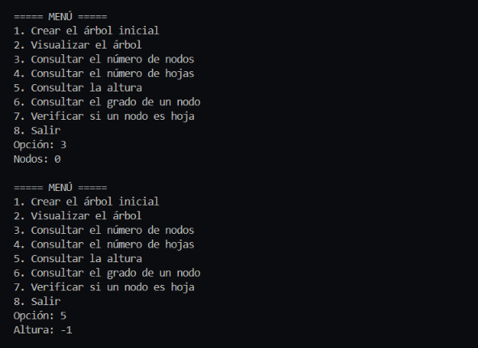
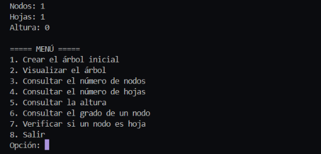
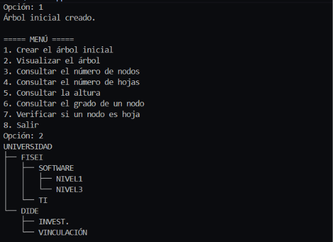
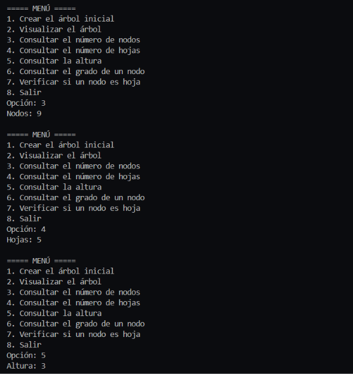
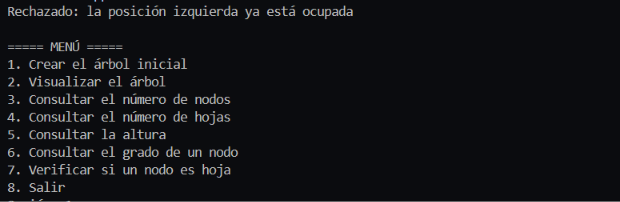
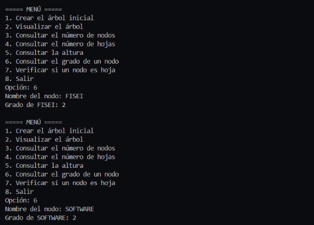

# T6-ArbolBinario-EspinozaKerly
# T6 - Árbol Binario en Java

**Asignatura:** Estructura de Datos
**Nivel:** Tercero - Ingeniería de Software
**Estudiante:** Espinoza Kerly

## 1. Problema

La Universidad necesita representar la organización de sus dependencias académicas mediante un árbol binario. Cada nodo almacena el nombre de una dependencia y tiene como máximo dos hijos.

El programa permite construir el árbol, visualizarlo y analizarlo (número de nodos, número de hojas, altura, grado de un nodo y si un nodo es hoja). Está hecho en Java con programación orientada a objetos. El conteo de nodos, el conteo de hojas y la altura se calculan con recursividad.

## 2. Estructura del árbol

```
UNIVERSIDAD
├── FISEI
│   ├── SOFTWARE
│   │   ├── NIVEL1
│   │   └── NIVEL3
│   └── TI
└── DIDE
    ├── INVEST.
    └── VINCULACIÓN
```

- **Nodos:** 9
- **Hojas:** 5 (NIVEL1, NIVEL3, TI, INVEST. y VINCULACIÓN)
- **Altura:** 3 aristas (camino más largo: UNIVERSIDAD → FISEI → SOFTWARE → NIVEL1)

### Organización del proyecto

```
src/
 ├── modelo/
 │    └── Nodo.java
 ├── negocio/
 │    └── ArbolBinario.java
 └── app/
      └── Main.java
```

- `Nodo<T>`: guarda el dato y las referencias a los hijos izquierdo y derecho. Incluye `esHoja()` y `grado()`.
- `ArbolBinario<T>`: crea la raíz, agrega hijos, cuenta nodos y hojas, calcula la altura y muestra el árbol.
- `Main`: menú interactivo con `Scanner`.

## 3. Instrucciones de ejecución

Requisito: tener instalado el JDK de Java.

Desde la carpeta raíz del repositorio:

```bash
javac -encoding UTF-8 -d out src/modelo/Nodo.java src/negocio/ArbolBinario.java src/app/Main.java
java -cp out app.Main
```

También se puede ejecutar desde Visual Studio Code abriendo `Main.java` y presionando *Run*.

### Menú del programa

```
1. Crear el árbol inicial
2. Visualizar el árbol
3. Consultar el número de nodos
4. Consultar el número de hojas
5. Consultar la altura
6. Consultar el grado de un nodo
7. Verificar si un nodo es hoja
8. Salir
```

## 4. Resultados

### Caso 1: árbol vacío
Antes de crear el árbol: 0 nodos y altura -1.



### Caso 2: árbol con un solo nodo
Solo la raíz: 1 nodo, 1 hoja y altura 0.




### Caso 3: árbol inicial
Después de crear el árbol: 9 nodos, 5 hojas y altura 3.



### Caso 4: insertar un hijo en una posición ocupada
El intento es rechazado porque la posición ya tiene un hijo.



### Caso 5: grado de FISEI y SOFTWARE
FISEI tiene grado 2 y SOFTWARE tiene grado 2.



### Resumen

| Caso | Resultado esperado | 
|------|--------------------|
| Árbol vacío | 0 nodos, altura -1 | 
| Un solo nodo | 1 hoja, altura 0 | 
| Árbol inicial | 9 nodos, 5 hojas, altura 3 | 
| Posición ocupada | Inserción rechazada |
| Grado de FISEI y SOFTWARE | 2 y 2 |
